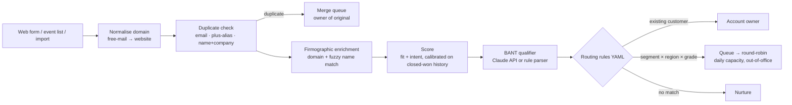
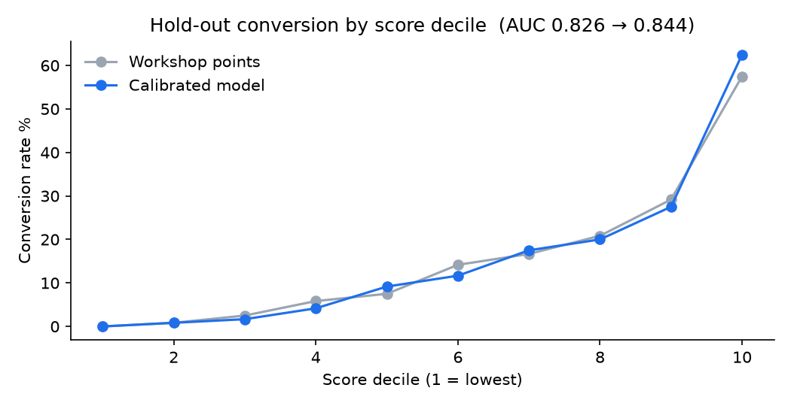
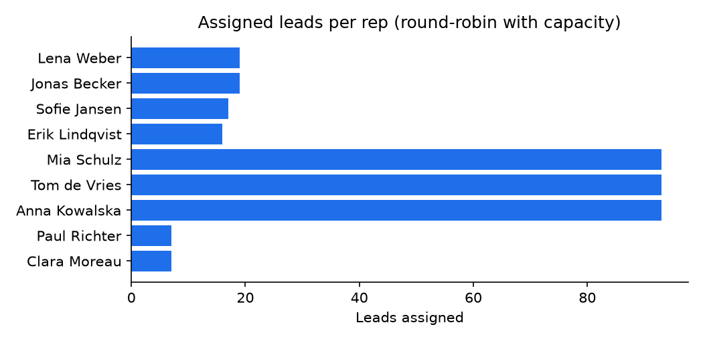

# GTM Lead Routing Engine

Inbound leads lose value by the hour. Most teams still route them with a long chain of CRM
workflow rules that nobody fully understands. Duplicates create two owners for one person, and
lead scores are set in a workshop once and never checked again.

This project is a small, testable service that does the whole lead-to-owner step in one place:

**enrich → de-duplicate → score → qualify (BANT) → route → SLA**

It runs locally, in Docker or in CI. The routing rules are YAML, so RevOps can change them without a deploy.



## Results (synthetic but realistic data, fully reproducible)

The data generator creates 403 companies, 6,000 historical leads with closed-won outcomes, and 1,460 new
inbound leads with 118 planted duplicates. The outcomes come from a hidden conversion process. The
"workshop" points in `scoring.py` deliberately disagree with it in places, the way real ones do:
Retail is overrated, enterprise is valued above mid-market, and paid search is rated higher than referrals.

| | Workshop points | Calibrated model |
|---|---|---|
| AUC on the most recent 20% (time split) | 0.826 | **0.844** |
| Conversion in top 10% vs. average | 3.71× | **4.03×** |



What calibration changed (learned weights, log-odds):

* **Mid-market beats enterprise** (1.46 vs 1.07). The workshop had them the other way round.
* **Referrals are the strongest source** (1.26). Paid search is slightly negative (−0.11), where the workshop gave it points.
* **A demo request** (1.57) and **seniority** (1.45) are the biggest single signals.

Pipeline on 1,460 new leads:

| Step | Result |
|---|---|
| Duplicates found (email case, `+alias`, same name at the same company) | 118 / 118 planted, 0 false positives |
| Existing customers sent to their account owner | 8 |
| Routed to sales queues | 364 (enterprise DACH 38, enterprise Europe 33, mid-market 279, SMB 14) |
| Sent to nurture (grade D, unknown company) | 970 |
| Mid-market load spread across 3 reps | 93 / 93 / 93 |



The duplicate test set covers the common variants (same email with different casing, `+alias`,
same person with a second address at the same company). Real CRM data also has typos and name
changes; the next step there is fuzzy name matching with a review queue.

## How it works

| Module | What it does |
|---|---|
| `enrich.py` | Domain normalisation; free-mail detection (uses the website instead); firmographic lookup by domain with a fuzzy company-name fallback (`GmbH`, `B.V.`, `AB` … stripped); duplicate detection incl. Gmail dot/`+alias` rules |
| `scoring.py` | 13 explainable features (fit: industry, size, region, seniority; intent: demo, page views, source, urgency in the message). Scores either with workshop points or with a logistic regression trained on history. Every score returns its top reasons, e.g. `+demo, +size_mid, -free_mail` |
| `qualifier.py` | BANT extraction from the free-text message. Uses the Claude API when `ANTHROPIC_API_KEY` is set, and a deterministic rule parser otherwise, so tests and CI never depend on a network call |
| `routing.py` | Ordered YAML rules on segment, region, grade and score; account-owner match first; round-robin per queue that skips reps who are away or at their daily capacity; SLA per queue |
| `api.py` | FastAPI: `POST /leads`, `GET /rep-load`, `GET /health` |

Routing rules (excerpt from `config/routing.yaml`):

```yaml
rules:
  - name: hot_enterprise_dach
    queue: enterprise-dach
    when: {segment: Enterprise, region: DACH, grade: [A, B]}
  - name: midmarket_qualified
    queue: midmarket
    when: {segment: Mid-Market, grade: [A, B, C]}
  - name: smb_demo_or_good_score
    queue: smb-inside-sales
    when: {segment: SMB, score: {gte: 40}}
```

## Run it

```bash
pip install -e ".[dev]"
python scripts/generate_data.py   # synthetic companies, history and inbound leads
python scripts/evaluate.py        # trains the model, runs the pipeline, writes docs/results.json + charts
pytest -q                         # 18 tests

uvicorn leadrouter.api:app --reload
curl -X POST localhost:8000/leads -H 'content-type: application/json' -d '{
  "email": "jonas@hansa-logistik.de", "first_name": "Jonas", "last_name": "Kraus",
  "title": "VP Operations", "demo_requested": true,
  "message": "Budget approved, we need this live this quarter."}'
```

Or with Docker: `docker build -t leadrouter . && docker run -p 8000:8000 leadrouter`.

The response contains the enriched company, the score with reasons and grade, the BANT summary, and the
routing decision (owner, queue, rule and SLA in minutes).

## Connecting it to a CRM

The service is CRM-agnostic. In production it sits behind a webhook:

* **Salesforce / HubSpot / Zoho**: a "lead created" webhook or flow calls `POST /leads`, then writes back `owner`, `score`, `grade` and the BANT summary to lead fields.
* **n8n / Zapier**: an HTTP Request node calls the API, then an update node in the CRM.
* The calibrated model is retrained monthly from closed-won data with `scripts/evaluate.py`, and the AUC/lift table is the check before new weights go live.

## Project layout

```
config/routing.yaml      queues, reps, capacities, rules, account owners
data/                    generated data + trained model.json
docs/                    results.json and charts
scripts/                 generate_data.py, evaluate.py
src/leadrouter/          enrich, scoring, qualifier, routing, pipeline, api
tests/                   unit + API tests
```
